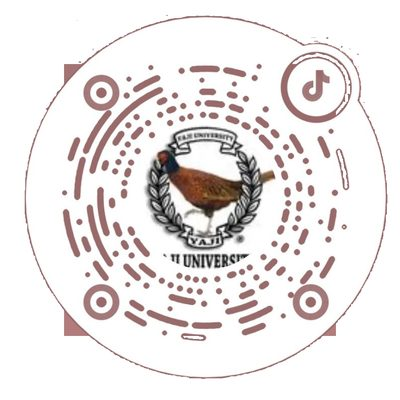

# 特斯拉哨兵云盘 · Tesla Sentry Drive

**虚拟哨兵 U 盘 · 多路同步回放 · SEI 行车遥测 · 水印导出 —— 跑在任意 USB Gadget 设备上。**

[](LICENSE)
[](https://www.python.org/)
[](#功能)

拿一台小 Linux 设备（随身 WiFi / 开发板 / OpenWrt 路由器）顶替原车 U 盘插进手套箱：车机照常录制，手机连盒子 WiFi 打开网页就能回看 4 / 6 路同步画面、逐帧读视频码流里的 SEI 遥测（挡位 / 车速 / 油门 / 刹车 / 方向盘 / 转向灯 / AP / 坐标），并导出带行车信息水印的视频。

没有 USB Device 模式的机器（多数 x86 / NAS / 软路由）也能用：把 `TeslaCam/` 拷进本机，跑 `TSF_ARCHIVE=/path python3 sentry-viewer.py` 就是纯网页查看器。按设备能力分 **A 完整部署 / B 半自动归档 / C 仅网页** 三档，见[支持设备](#支持设备)。

仓库名来自参考机型**中兴 F50 存储版**（全功能实测），项目本身不绑机型 · [部署速览图](docs/overview.png)

---

## 功能

| 能力 | 说明 |
|---|---|
| 🗂 虚拟 U 盘 | 默认 64G 稀疏 exFAT 镜像，通过 USB Gadget `mass_storage` 导出；车机提示「格式化 USB 设备」点确认即可，网卡 / 串口共存 |
| ⚡ 实时查看 | `tesla-live-sync.py` 每 15 秒**只读解析 exFAT**（不挂载、不断 USB），车机边写网页边看，新片段通常 15–30 秒出现；cron `*/10` 只负责写 Boombox 音频 |
| 📦 归档与滚动窗口 | 视频落到独立 ext4 归档区，不与车机同时读写镜像；`RecentClips` 跟随车机滚动缓冲只留最近 60 分钟，`SentryClips` / `SavedClips` 的**盒子副本**默认按 14 天 / 12GB 清理（车机 U 盘那份只读不动），`.pruned` 墓碑避免「删除→重抄」死循环 |
| 🎬 多路播放 | 4 路 2×2 / 6 路 3×2 自适应，250ms 同步校正（偏差 >1.2s 硬 seek，0.05–1.2s 微调倍速 0.88–1.12）、统一进度条、0.5–4x、单格放大、分钟级片段分组与缩略图 |
| 📊 遥测与元数据 | 直读码流内嵌 SEI protobuf：挡位 / 车速 / 油门 / 刹车 / 方向盘角度 / 转向灯 / AP 状态 / 坐标 / 三轴加速度，随进度逐帧跳动；`event.json` 提供时间 / 城市 / 街道 / 触发原因 / 触发画面 |
| 🔍 筛选与预览 | 触发原因 + 日期胶囊叠加筛选；`?ev=` `?date=` `?cat=` `?cam=` `?exp=1` 深链；📡 实时预览页、存储条与在线同步状态 |
| 📶 清晰度 | 播放可选 原画 / 720p / 480p / 360p（服务端转码缓存，2 并发、上限 2GB），内网默认原画、公网默认 360p |
| 🎞 导出 | 单路下载、zip 打包（可选清晰度）、浏览器本机 canvas 合成多路 webm / mp4（2×2、3×2，固定原画）；导出水印由**前端 canvas** 烧录，服务端 ASS 水印只用于飞书推送短视频 |
| 📂 文件管理 | U 盘 / 归档区浏览上传下载，多选批量删除 / 移动 / 复制 / 重命名（realpath 防逃逸）；一键清空 `TeslaCam/` 全部录像（保留目录结构、不动 Boombox / Wraps）；U 盘管理模式 5 分钟无操作自动恢复导出 |
| 🔔 飞书推送 | 私聊（仅本人）/ 群机器人，触发那一帧封面卡片或触发点前 5 秒短视频，可烧行车信息水印；去重、延迟 20 秒、失败重试 3 次，导出浮层也能直接推送 |
| 🔐 登录保护 | `install.sh` 默认生成随机 10 位密码（admin），HMAC 签名 cookie 保留 30 天 + HTTP Basic；10 分钟内连错 8 次返回 429；设置 → 账号可改密码 / 退出 |
| 🔄 在线升级 | 多源并发竞速 + GitHub API 实时兜底，下载后校验 → 备份 → 原子替换 → 自动重启，出问题一键回滚 |
| 🎨 个性化 | 深 / 浅 / 自动主题、10 种界面语言、网页背景换肤、锁车音（`LockChime.wav`）、涂装 `Wraps/` |
| 🛡 稳定性 | 归档区 ext4 日志式、开机自检、服务自动拉起、LUN 被弹出后 cron `*/2` 自动重挂、断电自愈 |

---

## 支持设备

| 档位 | 需要什么 | 能做什么 | 典型设备 |
|---|---|---|---|
| **A 完整部署** | USB Device(Gadget) + 内核 exFAT + root | 虚拟 U 盘 + 车机无感实时同步 + 全部网页功能 | 中兴 F50、随身 WiFi、开发板 |
| **B 半自动** | 任意 Linux + 存储 | 手动把 `TeslaCam/` 拷进归档区，网页功能照常 | NAS、软路由、旧笔记本 |
| **C 仅网页** | Python 3.7+ | 归档目录已存在（NFS / SMB 也行），只当浏览前端 | 任何机器，含 x86 |

**已实测**：中兴 F50 存储版（紫光展锐 T760 / aarch64 / 1.4G RAM / eMMC 256G，OpenWrt 25.12.5、内核 7.2.9、`25100000.dwc3`）完整跑通，车机为 2022 Model Y（4 路摄像头）。树莓派 Zero 2 W 等 OTG 开发板推断可行但需自检；x86 / NAS 只能跑 B / C 档。

**档位 A 硬门槛**：`/sys/class/udc/` 非空、configfs + `USB_F_MASS_STORAGE`、内核 exFAT、loop / losetup、root，且车机 USB 口能供电。建议 ≥32G 存储（镜像 + 归档各占一部分）、Python 3.7+（查看器零第三方依赖）；ffmpeg 只影响缩略图与转码，缺失不阻塞安装。

装之前先自检（只读、不改系统）：

```sh
sh scripts/tsf-check.sh          # 逐项检查 UDC / configfs / exFAT / Python / init，三色结论
sh scripts/tsf-check.sh --json   # 供脚本判定
```

完整设备清单、各系统适配度与功能降级矩阵见 [docs/COMPATIBILITY.md](docs/COMPATIBILITY.md)。

---

## 安装

**1. 部署**（在设备 SSH 里执行）

```sh
git clone https://github.com/baicyber/tesla-sentry-f50.git
cd tesla-sentry-f50
sudo ./install.sh                                             # 默认 64G 镜像 + /archive + 端口 8080
sudo ./install.sh --size 200 --port 8080 --archive /archive    # 自定义参数
```

安装会：检查内核 gadget / exFAT / Python → 建稀疏镜像 → 装到 `/opt/tesla-sentry/`、写 `/etc/tesla-sentry.conf` → 注册 `tesla-gadget` / `tesla-viewer` / `tesla-live` 三个服务（OpenWrt procd、systemd 或 rc.local）与两条 cron → 生成随机登录密码 → 启动并打印状态。ffmpeg、字体、部分内核项缺失只警告不中止。

**2. 插到车上**：插进手套箱 USB 口 → 车机提示「**格式化 USB 设备**」→ 点确认，车机会自建 `TeslaCam/{SentryClips,SavedClips,RecentClips}`。

**3. 打开网页**：`http://<设备IP>:8080`（手机连设备热点、USB 网卡直连，或自行加 Tailscale / frp）。首次登录账号 `admin`，密码见安装输出或 `/opt/tesla-sentry/auth.conf`。视频由 15 秒在线同步落地，不用等定时归档。

**卸载**

```sh
sudo ./uninstall.sh              # 停服务、删脚本，保留镜像和归档数据
sudo ./uninstall.sh --purge      # 连镜像和归档一起删（不可恢复）
```

---

## 配置与常用设置

主配置 `/etc/tesla-sentry.conf`（改完重启服务生效）：

| 变量 | 默认 | 作用 |
|---|---|---|
| `TSF_IMG` / `TSF_ARCHIVE` | `/opt/tesla-sentry/teslacam.img` / `/archive` | 虚拟 U 盘镜像 / 归档区 |
| `TSF_PORT` | `8080` | 网页端口 |
| `TSF_LIVE_INTERVAL` | `15` | 在线只读同步轮询秒数 |
| `TSF_IDLE` | `600` | 镜像空闲秒数，仅用于 cron 挂载写 Boombox 音频 |
| `TSF_RECENT_ROLL_MIN` | `60` | RecentClips 滚动窗口（分钟），0 = 不滚动 |
| `TSF_BOX_KEEP_DAYS` / `TSF_BOX_MAX_GB` | `14` / `12` | 盒子侧哨兵 / 手动保存归档的保留天数与单分类上限，0 = 不限 |
| `TSF_FREE_MIN_MB` / `TSF_FREE_TARGET_MB` | `4096` / `10240` | 空间兜底清理的触发阈值与目标 |
| `TSF_CACHE` | 自动 | 缩略图 / 遥测 / 转码缓存目录 |

OTA、飞书推送、认证的参数**不写入这个 conf**，走环境变量（如 `TSF_OTA_SOURCES`、`TSF_OTA_REPO`）或网页配置。完整变量表见 `docs/COMPATIBILITY.md` 第 8 节。

网页 **⚙ 个性化** 有 8 个子页签：文件、锁车语音、涂装、推送、账号、语言、网页背景、更新。

- **在线升级**：设置 → 更新，自动比对仓库 `version.json`，一键升级 / 回滚；配置与录像归档不在升级范围内。
- **飞书推送**：设置 → 推送，用自建应用私聊（仅本人）或群机器人 webhook，支持封面卡片与触发摄像头短视频，配好先点「发送测试」。
- **认证**：凭据在 `/opt/tesla-sentry/auth.conf`（权限 600）；删除该文件并重启即关闭认证（仅建议纯内网）。
- **U 盘管理模式**：点「连接车机U盘」会临时停止导出并挂载镜像，5 分钟无操作自动恢复；行车 / 哨兵活跃时不要长时间挂着。
- **锁车音**：WAV、44.1kHz、16-bit、<1MB、1–5 秒，文件名 `LockChime.wav` 写入 U 盘根目录。
- **API**：事件、媒体、遥测、上传、文件管理、OTA、推送等数十个接口，以 `sentry-viewer.py` 的 `do_GET` / `do_POST` / `do_DELETE` 为准。

改完配置重启服务：

```sh
/etc/init.d/tesla-viewer restart
/etc/init.d/tesla-live restart
/etc/init.d/tesla-gadget restart
```

---

## 常见问题

- **车机不认盘**：确认 `/sys/class/udc/` 有控制器、`grep exfat /proc/filesystems` 有输出，再跑 `/opt/tesla-sentry/tesla-gadget.sh status`；新盘首次插车提示格式化属正常。
- **播放黑屏**：视频是 H.265 / HEVC，Windows 用 Edge / Chrome（需 HEVC 解码器）、iPhone Safari 原生支持，部分安卓浏览器不支持。
- **网页没有事件**：看 `/opt/tesla-sentry/` 下的 `tesla-live.log`、`tesla-sync.log`；先确认顶部同步状态胶囊在线，再核对归档目录与镜像路径。

更多排障见 [docs/TROUBLESHOOTING.md](docs/TROUBLESHOOTING.md)；实现原理（exFAT 只读解析、双链路互斥、SEI 解码、U 盘管理状态机）见 [docs/ARCHITECTURE.md](docs/ARCHITECTURE.md)。

---

## 安全提示

- `install.sh` 默认开启全站登录保护；**直接裸跑 `python3 sentry-viewer.py` 且没有 `auth.conf` 时认证是关闭的**，只可在可信内网使用。
- 上传限制 100MB，路径被约束在归档区 / 镜像挂载点内，不可逃逸到系统目录。
- 认证走 HTTP 明文，公网访问务必套 HTTPS 或 VPN。

## 免责声明

本项目为个人爱好项目，与特斯拉公司无关。修改车机存储行为存在风险（数据丢失、录制中断等），请自行评估，建议先用小容量镜像验证。

## 参考与致谢

- [teslausb](https://github.com/marcone/teslausb) —— 树莓派伪装 U 盘归档的开山之作，本项目思路来源
- [SentryBox](https://github.com/weitanism/sentrybox) —— 车机常驻设备的产品化实践
- [tesla-sentry-viewer](https://github.com/denysvitali/tesla-sentry-viewer) —— 网页查看器形态参考

## ☕ 赞助

> 本项目完全开源免费，如果它帮到了你，欢迎支持博主一些token，助力项目持续更新~

<table>
  <tr>
    <td align="center"><br><sub><b>支付宝</b></sub></td>
    <td align="center"><br><sub><b>微信支付</b></sub></td>
  </tr>
</table>

## 💬 交流群

> 遇到问题、想交流玩法，欢迎扫码加入群聊~

<table>
  <tr>
    <td align="center"><br><sub><b>QQ 群：831426822</b></sub></td>
    <td align="center"><br><sub><b>微信群</b>（二维码 11月12日前有效，过期进群请联系作者或QQ群）</sub></td>
  </tr>
</table>

**交流加群请联系作者**：群二维码过期、或想直接交流玩法，可关注抖音 `@耶基大学懂事长`（抖音号 `yejiuni`），或扫码添加作者微信好友拉你进群。

<table>
  <tr>
    <td align="center"><br><sub><b>抖音 · @耶基大学懂事长</b></sub></td>
    <td align="center"><br><sub><b>微信 · 联系作者</b></sub></td>
  </tr>
</table>

## License

[MIT](LICENSE)
